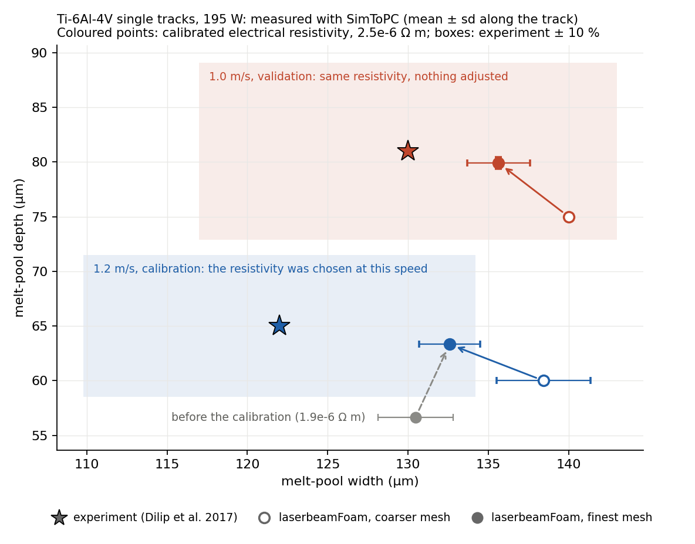

# Validation of `laserbeamFoam` against single tracks of Ti-6Al-4V

This folder compares the width and the depth of the melt pool predicted by
`laserbeamFoam` with the experiments of Dilip et al. (2017) [1] for single
tracks of Ti-6Al-4V at 195 W. The fields are produced by `laserbeamFoam`,
they are measured with our in-house tool [SimToPC][simtopc], and the numbers
that SimToPC gives are set next to the experimental ones.

The folder holds the inputs of the cases, the results of SimToPC and the
script that draws the comparison. The computed fields are not included
(0.2 to 0.8 GB per case for the last time alone).

In short: one parameter of the model was calibrated at 195 W and 1.2 m/s,
and the calibrated model was then tested at the same power and 1.0 m/s. On
the finer mesh the tested case is 4 % wider than the experiment and one cell
or less shallower. The
sections "Calibration and validation", "Mesh dependence" and "Limits" say
what this does and does not show.

---

## The experiments

Dilip et al. [1] made single tracks of Ti-6Al-4V on a plate with a powder
layer of 30 µm, cut them across the track, and measured the width of the
melt pool at the surface of the plate and its depth below that surface on
the etched cross-sections (the sketch of their Fig. 5). The cross-sections
were cut at three positions along tracks of 100 mm. The values are in
`results/dilip2017.csv`.

| Power (W) | Scan speed (m/s) | Width (µm) | Depth (µm) |
|-----------|------------------|------------|------------|
| 195 | 1.2 | 122 | 65 |
| 195 | 1.0 | 130 | 81 |

> **Note on the experimental values.** The paper gives the widths and the
> depths only as points in a plot (its Fig. 6), not as numbers. We read them
> off that figure as carefully as we could, by measuring the position of
> the points on a high-resolution rendering of the figure. The reading
> uncertainty is about ±3 µm, and the paper gives no scatter bars.

---

## The cases

Each scan speed is run on two uniform meshes of cubic cells. The two meshes
of a scan speed use the same box.

| Case | Speed (m/s) | Cell (µm) | Box x × y × z (µm) | Cells | Track in z (µm) | Cores |
|------|-----|------|------------------|-----------|----------|-----|
| `v1200_5um`    | 1.2 | 5    | 300 × 380 × 1400 | 1 276 800 | 100–1300 | 128 |
| `v1200_3.33um` | 1.2 | 3.33 | 300 × 380 × 1400 | 4 309 200 | 100–1300 | 512 |
| `v1000_5um`    | 1.0 | 5    | 300 × 500 × 1600 | 1 920 000 | 300–1500 | 128 |
| `v1000_3.33um` | 1.0 | 3.33 | 300 × 500 × 1600 | 6 480 000 | 300–1500 | 512 |

A fifth case, `v1200_3.33um_baseResistivity`, is `v1200_3.33um` before the
calibration described below: its files are the same except one line of
`constant/transportProperties`.

- **Axes:** `x` across the track, `y` vertical, `z` along the scan.
- **Plate:** 150 µm thick, from `y = 0` to `y = 150 µm`.
- **Powder:** particles of 15 to 43 µm in diameter (`constant/location`,
  read by `setSolidFraction`), from a discrete element simulation in which
  the particles whose centre lay more than 30 µm above the plate were
  removed. The tops of the particles reach 44 µm above the plate, and the
  metal in the layer is about 0.70 of a full layer of 30 µm. The 1.0 m/s
  box holds the same particles as the 1.2 m/s box under the track, plus
  those of the extra length.
- **Laser:** 195 W, radius 50 µm (a beam diameter of 100 µm is assumed for
  the experiments), wavelength 1.064 µm, with ray tracing. The track is
  1200 µm long. The run continues for 1 ms after the laser is switched off,
  so that the track solidifies.
- **Material:** Ti-6Al-4V, with the properties listed in the section
  "Material properties" below.
- **Box of the 1.0 m/s cases:** it is taller and longer than that of the
  1.2 m/s cases, with 300 µm behind the start of the track instead of 100.
  In a run at 1.0 m/s on the fine mesh in the smaller box, the mound of
  metal that forms behind the start of the track reached the top of the box
  at the back wall, and metal was lost.
- **Time step:** `maxDeltaT` is 1e-8 s while the laser is on and larger
  during the cooling. The function object `maxDeltaTByPhase` of
  `system/controlDict` switches between `controlDict.laserOn` and
  `controlDict.cooling`.

### Checks made on every run

- **Metal conservation.** The volume of metal printed by the solver
  ("Phase-1 volume fraction") changes by less than 0.0003 % between the
  start and the end of each run, so no measurable metal left the box.
- **Walls.** The cells next to the walls were searched for cells that
  melted at some time (`meltHistory > 0`). In four of the five runs there is
  none: the melt pool did not reach a wall. In `v1200_5um` a spatter
  droplet of about one cell stuck to a side wall, 125 µm above the plate
  and away from the melt pool; it does not enter any measured
  cross-section. In `v1000_5um` one cell of the top row was liquid for nine
  time steps and holds no metal at the end.

---

## Material properties

The properties of the metal come from two sources: Table 5.4 of the thesis of
Parivendhan [2], and the `cunninghamValidation` tutorial of this repository
(`tutorials/laserbeamFoam/cunninghamValidation/constant`) for what that
table does not give. They are in `constant/transportProperties`, except the
electron number density, which is in `constant/LaserProperties`.

| Property | Keyword | Value | Source |
|----------|---------|-------|--------|
| Kinematic viscosity (m²/s) | `nu` | 0.8e-6 | [2], Table 5.4 |
| Density (kg/m³) | `rho` | 4100 | [2], Table 5.4 (solid) |
| Solidus, liquidus (K) | `Tsolidus`, `Tliquidus` | 1878, 1928 | [2], Table 5.4 |
| Latent heat of fusion (J/kg) | `LatentHeat` | 2.85e5 | [2], Table 5.4 |
| Thermal conductivity (W/m/K) | `poly_kappa` | −0.797 + 18.2e-3 T − 2e-6 T² | [2], Table 5.4 (solid), one coefficient corrected |
| Specific heat (J/kg/K) | `poly_cp` | 512.4 + 0.15 T + 1e-6 T² | [2], Table 5.4 (solid) |
| Surface tension (N/m) | `sigma` | 1.68 | [2], Table 5.4 |
| Its temperature coefficient (N/m/K) | `Marangoni_Constant` | −2.6e-4 | [2], Table 5.4 |
| Vaporisation temperature (K) | `Tvap` | 3533 | [2], Table 5.4 |
| Latent heat of vaporisation (J/kg) | `LatentHeatVap` | 9.8e6 | [2], Table 5.4 |
| Ambient pressure (Pa) | `p0` | 101000 | [2], Table 5.4 |
| Emissivity, solid and liquid | `emS`, `emL` | 0.2, 0.2 | [2], Table 5.4 |
| Thermal expansion coefficient (1/K) | `beta` | 6.2e-5 | `cunninghamValidation` |
| Molar mass (kg/mol) | `Mm` | 0.05 | `cunninghamValidation` |
| Reference temperature (K) | `TRef` | 300 | `cunninghamValidation` |
| Electron number density (1/m³) | `e_num_density` | 1.11e30 | `cunninghamValidation` |
| Electrical resistivity (Ω m) | `elec_resistivity` | 2.5e-6 | calibrated here; 1.9e-6 in `cunninghamValidation` |
| Gas (all properties) | `gas` | see the file | `cunninghamValidation` |

Three points where the values of [2] are not used as printed:

- **One phase for the solid and the liquid.** `laserbeamFoam` has one
  density and one polynomial of conductivity and of specific heat for the
  metal. The values of the solid of Table 5.4 are used for both; the values
  that the table gives for the liquid are not used.
- **Conductivity.** The quadratic coefficient is −2e-6. The value printed in
  Table 5.4 makes the conductivity negative at every temperature, so it is
  taken as a misprint.
- **Molar mass.** Table 5.4 prints 0.446 kg/mol, about nine times the molar
  mass of the alloy. The 0.05 kg/mol of `cunninghamValidation` is kept.

The absorption is not a property given by the user: the solver calculates
the absorptivity of the metal from the electrical resistivity, the electron
number density and the wavelength, with ray tracing. The fixed absorption
of 0.5 of [2] is therefore not used.

---

## Calibration and validation

One parameter of the model was calibrated: the electrical resistivity of the
metal (`elec_resistivity`), which sets the absorptivity and, with it, the
power that the metal absorbs.

### How the model reached its present form

All the runs of this table are at 1.2 m/s on 5 µm cells, in a box of
300 × 280 × 1400 µm, and are measured in the same window as the cases of
this folder. Their fields are not part of the folder. "Absorbed" is the
power deposited in the metal divided by the laser power, averaged while the
laser crosses the window.

| Model | Width (µm) | Depth (µm) | Difference from [1] | Absorbed |
|-------|------------|------------|---------------------|----------|
| Properties of `cunninghamValidation` | 130.2 ± 1.1 | 45.0 ± 0.0 | +6.7 % / −30.8 % | 0.58 |
| Properties of [2] | 133.8 ± 3.7 | 54.7 ± 1.1 | +9.7 % / −15.8 % | 0.60 |
| Properties of [2], resistivity 2.5e-6 Ω m | 137.6 ± 3.3 | 60.0 ± 0.0 | +12.8 % / −7.7 % | 0.65 |

1. **Material properties.** With the Ti-6Al-4V properties of the
   `cunninghamValidation` tutorial the melt pool was 31 % too shallow. The
   properties of [2] were adopted (see "Material properties") and the
   deficit fell to 16 %.
2. **Parameters tried without effect on the depth.** Three other parameters
   were changed one at a time on the model with the properties of [2]: the
   temperature coefficient of the surface tension (to −5.5e-4 N/m/K), the
   viscosity (to 3.5e-7 m²/s) and the molar mass (to 0.0446 kg/mol). The
   first widened the track by about 6 µm; none changed the depth by more
   than a fraction of a cell.
3. **Electrical resistivity.** The resistivity was raised once, by about
   30 %, from 1.9e-6 to 2.5e-6 Ω m. It was the only change that moved the
   depth. The value was not optimised further.

The choice was made on the 5 µm mesh. The two 3.33 µm cases at 1.2 m/s of
this folder, with 1.9e-6 and with 2.5e-6 Ω m, were run afterwards in the
same box, to show the effect of the calibration on the finer mesh:

| Case | Width (µm) | Depth (µm) | Difference from [1] | Absorbed |
|------|------------|------------|---------------------|----------|
| `v1200_3.33um_baseResistivity` | 130.5 ± 2.3 | 56.7 ± 0.0 | +6.9 % / −12.8 % | 0.60 |
| `v1200_3.33um` | 132.6 ± 1.9 | 63.3 ± 0.0 | +8.7 % / −2.6 % | 0.66 |

The calibration brings the depth to the experiment and makes the width
slightly worse.

### The validation

The 1.0 m/s cases were run with the same material properties and the same
2.5e-6 Ω m. Their result was not used to choose the value, which was fixed
before any run at 1.0 m/s with it. On the 3.33 µm mesh they gave 135.6 µm
and 79.9 µm, +4.3 % and −1.3 % from the experiment.

Two things were decided after results at both speeds had been seen: the
larger box of the 1.0 m/s cases, and the rules of the measurement (the
window and the row in which the width is taken; see "How the melt pool is
measured"). The rules are applied in the same way to all the cases.

Runs at 0.75 and 0.5 m/s were also started, on the 5 µm mesh in a box of
300 × 280 × 1400 µm, and are not reported. At 0.75 m/s the metal reached
the top of the box and the run was discarded. The run at 0.5 m/s was
stopped before its end.

### What the calibrated value means

The value 2.5e-6 Ω m is a calibration, not a measurement of the resistivity
of the alloy. Measured values near the melting point are lower: 1.58e-6 Ω m
for the liquid and 1.62e-6 Ω m for the solid at the liquidus [4], and
1.90e-6 and 1.92e-6 Ω m at the solidus and the liquidus when the thermal
expansion is taken into account [3]. The value used here is about 30 %
above the highest of them.

What the calibration changes in the model is the absorbed power. On the
3.33 µm mesh at 1.2 m/s the metal absorbs 0.60 of the laser power with
1.9e-6 Ω m and 0.66 with 2.5e-6 Ω m. The calibrated resistivity should be
read as an effective parameter that makes up for absorption which the model
does not capture otherwise.

---

## How the melt pool is measured

The cases are measured with the metallographic mode of SimToPC, which
measures a simulated track as an etched cross-section is measured in the
laboratory. It is described, with a figure of a cross-section of
`v1000_5um`, in [METALLOGRAPHIC_MODE.md][mode]. In short:

- The fusion zone is the set of cells that melted at some time
  (`meltHistory > 0`, written by the `meltPoolHistory` function object).
- **Width:** from the outer edge to the outer edge of the fusion zone in the
  row of cells just below the plate top (`y = 150 µm`). When an edge cell of
  that row is not metal at the final time, the width is taken one row
  lower, and at most two rows lower. That happened in 2, 6 and 9
  cross-sections of `v1000_5um`, `v1000_3.33um` and
  `v1200_3.33um_baseResistivity`, always one row lower.
- **Depth:** from the plate top to the bottom of the lowest melted cell that
  is metal at the final time. It is a whole number of cells.
- **Fill:** the metal fraction of the fusion zone at and below the plate
  top, at the final time. It is the control of the shape of the track.
- Width and depth are measured in every cross-section of the mesh (one per
  cell along the track) and averaged over a 400 µm window of the track.

### How the measurement window is found

The window is not chosen by eye. SimToPC finds it from the tracks with a
fixed rule, and it is the same for all the cases of a scan speed, so that
they are measured over the same part of the track:

1. **Profile.** The width and the depth are measured in every cross-section
   along the track.
2. **Steady stretch of a case.** The two profiles are smoothed with a
   running median of 50 µm. The steady stretch is the longest stretch of
   the track in which the smoothed width and the smoothed depth both stay
   within ±5 µm of their median over that stretch. It leaves out the start
   of the track, where the melt pool is still growing, and its end, where
   the last melt pool froze.
3. **Window of a scan speed.** It starts 50 µm after the latest start of the
   steady stretches of the cases of that speed, rounded up to a multiple of
   50 µm, and it is 400 µm long.
4. **Check.** The window must end inside the steady stretch of every case
   of that speed; otherwise SimToPC stops with an error.

Positions along the track are measured from the start of the laser, because
the tracks do not start at the same `z` in the two boxes. For the cases of
this folder (µm from the start of the laser):

| Case | Speed (m/s) | Steady stretch | Window |
|------|-------------|----------------|--------|
| `v1200_5um` | 1.2 | 397.5–1157.5 | 450–850 |
| `v1200_3.33um` | 1.2 | 241.7–1128.3 | 450–850 |
| `v1000_5um` | 1.0 | 402.5–1147.5 | 500–900 |
| `v1000_3.33um` | 1.0 | 435.0–1115.0 | 500–900 |
| `v1200_3.33um_baseResistivity` | 1.2 | 275.0–1135.0 | 450–850 |

At 1.2 m/s the latest start is 397.5 µm; 50 µm later is 447.5 µm, rounded
up to 450 µm, so the window is 450–850 µm, which ends before 1128.3 µm, the
earliest end of the steady stretches. At 1.0 m/s the latest start is
435.0 µm; 50 µm later is 485.0 µm, rounded up to 500 µm, so the window is
500–900 µm, which ends before 1115.0 µm.

The values of the rule (±5 µm, 50 µm, 400 µm) are those of the `config.yml`
of the SimToPC tutorial. The rule was fixed during the study (see
"Calibration and validation") and is applied in the same way to all the
cases.

The four cases with the calibrated resistivity are also the tutorial of
that mode in SimToPC (`examples/measure_metallographic`), where the same
numbers are the reference results.

---

## Results

`results/simtopcSummary.csv` is the summary written by SimToPC, and
`results/<case>/metallographic_profile.csv` is the width and the depth of
every cross-section along the track.

| Case | Width (µm) | Depth (µm) | Fill (%) | Experiment (µm) | Difference, width / depth |
|------|------------|------------|------|----------|------------------|
| `v1200_5um`    | 138.4 ± 2.9 | 60.0 ± 0.0 | 95.6 | 122 / 65 | +13.5 % / −7.7 % |
| `v1200_3.33um` | 132.6 ± 1.9 | 63.3 ± 0.0 | 92.5 | 122 / 65 | +8.7 % / −2.6 % |
| `v1000_5um`    | 140.0 ± 0.0 | 75.0 ± 0.0 | 88.7 | 130 / 81 | +7.7 % / −7.4 % |
| `v1000_3.33um` | 135.6 ± 2.0 | 79.9 ± 0.5 | 87.7 | 130 / 81 | +4.3 % / −1.3 % |
| `v1200_3.33um_baseResistivity` | 130.5 ± 2.3 | 56.7 ± 0.0 | 95.0 | 122 / 65 | +6.9 % / −12.8 % |

Mean ± standard deviation over the cross-sections of the window (80 on the
5 µm mesh and 120 on the 3.33 µm mesh). A standard deviation of 0.0 means
that every cross-section of the window gave the same number of cells.



*The solid arrows go from the 5 µm mesh to the 3.33 µm mesh. The dashed grey
arrow is the calibration: the same case before and after the resistivity
was changed. The shaded boxes are ±10 % of the experimental values and are
drawn only as a guide.*

> **Note on the comparison.** The two sets of points are not the same kind
> of number. Each simulated point is the mean over 80 or 120 cross-sections
> of a 400 µm window of one track, and its bars are the standard deviation
> along that window, that is, how much the melt pool varies along the
> track. Each experimental point is a single value read off a plot, from a
> few cross-sections of a much longer track, with no scatter reported and a
> reading uncertainty of about ±3 µm. The differences in the table should
> be read with both in mind.

> **Note on the resolution of the depth.** A depth is a whole number of
> cells, and one cell (5 or 3.33 µm) is 4 to 8 % of these depths. The
> differences in depth on the 3.33 µm mesh (−2.6 % and −1.3 %) are smaller
> than one cell and than the reading uncertainty of the experiment: they
> mean that the depth agrees within one cell, not within 2 %. The effect of
> the calibration on the depth is two cells.

On the 3.33 µm mesh, the validation case (1.0 m/s) is 4.3 % wider than the
experiment and agrees with it in depth within one cell. In all the cases
the width is larger than the experimental one and the depth is smaller. The
depth follows the experiment from 1.2 to 1.0 m/s (63 to 80 µm against 65 to
81 µm); the width rises less than in the experiment (133 to 136 µm against
122 to 130 µm).

`python3 plotValidation.py` prints this table and draws the figure from the
two files of `results/`. `addResults.py` (see "Adding a case") measures
completed cases with SimToPC and updates those files and the figure.

---

## Mesh dependence

The results depend on the mesh: from 5 µm to 3.33 µm the width falls by 4 to
6 µm and the depth rises by 3 to 5 µm, in both cases towards the experiment.
Mesh convergence has not been demonstrated:

- With two meshes the order of convergence cannot be observed. Assuming
  second order, the grid convergence index of the 3.33 µm mesh (refinement
  ratio 1.5, safety factor 3) is 10.6 % in width and 12.6 % in depth at
  1.2 m/s, and 7.7 % and 14.8 % at 1.0 m/s. These are as large as the
  differences from the experiment.
- At 1.2 m/s a coarser mesh of 6.25 µm was also run (in a box 381.25 µm
  high) and gave 137.5 µm and 61.2 µm. The sequence 6.25, 5, 3.33 µm is not
  monotonic, so a grid convergence index with three meshes was not
  calculated.
- A run with 2.5 µm cells at 1.2 m/s lost metal through the top of the box
  and was stopped. The mound of metal that forms at the start of the track
  grows as the mesh is refined (its top is at about 270 and 290 µm on the
  5 and 3.33 µm meshes, with the top of the box at 380 µm), so a finer mesh
  also needs a larger box.

The numbers of the 3.33 µm mesh are therefore the best estimate available,
not a mesh-independent result.

> **Note on finer meshes.** Finer meshes could be run in the future to
> settle the mesh dependence. They are not run for now because our budget
> of computing hours is limited: the cost grows quickly with the mesh (see
> the table of node-hours below), and the 2.5 µm run above alone is of the
> order of 100 node-hours.

---

## Limits

- **Shape of the track.** The simulated tracks are not full convex beads as
  in the micrographs of [1]. The fill of the fusion zone below the plate top
  is 88 to 96 % on average over the window, and as low as 75 % in single
  cross-sections of `v1000_5um`. In the row where the width is measured,
  part of the width ended as gas: there are grooves at the sides of the
  track and, in places, the centre of the track lies below the plate top
  (down to 18 µm in `v1000_5um`). The width reported is that of the fusion
  zone, from edge to edge, as it would be measured on a micrograph. The
  figure of [METALLOGRAPHIC_MODE.md][mode] shows one such cross-section.
- **Two neighbouring speeds.** The validation is at one speed, 17 % below
  that of the calibration, at the same power. It does not show how the
  model behaves far from the calibration point.
- **Boundaries.** The temperature has zero gradient on all the boundaries,
  including the bottom of the 150 µm plate, which is much thinner than a
  build plate, and the side walls at 150 µm from the axis of the track.
  The effect of the size of the box was checked in one case: `v1000_5um`
  gave the same width and depth (140.0 and 75.0 µm) in the box of
  300 × 380 × 1400 µm.
- **Steady stretch.** The window is the stretch where the width and the
  depth are steady. It is not a statement that the whole track is in a
  steady state.

---

## Solver version

These cases were run with the code of the tag
[`dilip-validation-solver`][solver] of the fork `ScimonCFD/LaserbeamFoam`.
It is `laserbeamFoam` at commit [119b0c74][base] of the branch
`OpenFoam_com_main` together with the changes of these pull requests, as
they stood at the beginning of November 2026:

- [#148][pr148], [#149][pr149], [#157][pr157], [#159][pr159] and
  [#160][pr160], now merged into `OpenFoam_com_main`;
- [#151][pr151], [#156][pr156] and [#169][pr169], which were still under
  review when these results were published;
- [#158][pr158], which was closed without merging. Its change was not
  active in these runs: their logs say that the temperature-independent
  terms of the energy equation are assembled in every correction.

The versions of the pull requests in that tag are those of that date.
Some of them changed afterwards, during their review, so the code is not
identical to `OpenFoam_com_main` plus the pull requests under review. The
runs used OpenFOAM v2506. Results with another version of the solver may differ
slightly; this has not been measured.

The case files use options of two of the pull requests:

- `longPause` in `constant/LaserProperties` ([#151][pr151]). It is not in
  `OpenFoam_com_main` yet. There the dictionary is not read, so the cooling
  after the laser is switched off would be solved in the full mode, which
  is slower. This was found by reading the source, not by running the cases
  on `OpenFoam_com_main`.
- `latentHeatMethod apparentCapacity` in `system/fvSolution`
  ([#159][pr159]), which is in `OpenFoam_com_main`.

---

## Running a case

The files of `results/` were produced with the solver of "Solver version",
and reproducing them needs that solver. `OpenFoam_com_main` does not have
`longPause` ([#151][pr151]) nor the other changes under review yet: there
the cooling would be solved in the slower full mode and the numbers may
differ. The cases have not been run on `OpenFoam_com_main`.

```bash
./Allrun_long v1200_5um
```

`Allrun_long` prepares the case (`blockMesh`, `setFields`,
`setSolidFraction`, `decomposePar`), runs `laserbeamFoam` on the number of
cores of `system/decomposeParDict` and reconstructs the last time. It calls
`mpirun` directly: on a cluster, call it from a job script. It does not
start on a case that holds anything a run writes (`0`, time directories,
`processor*` or `log.*`). `./Allclean_long v1200_5um`
removes what the run wrote and restores `system/controlDict`, which the
solver rewrites during a run.

The preparation steps of `Allrun_long` and the first hundred time steps of
`v1200_5um` were repeated on 8 cores and gave the same deposited power as
the original run. The scripts have not been used for a complete run: the
runs behind `results/` were launched by an equivalent job script.

The runs behind `results/` took, on nodes of 128 cores:

| Case | Cores | Wall time (h) | Node-hours |
|------|-------|---------------|------------|
| `v1200_5um`    | 128 | 5.7  | 6  |
| `v1200_3.33um` | 512 | 9.0  | 36 |
| `v1000_5um`    | 128 | 11.9 | 12 |
| `v1000_3.33um` | 512 | 19.3 | 77 |
| `v1200_3.33um_baseResistivity` | 512 | 8.7 | 35 |

---

## Adding a case

A new case is added by running it, measuring it locally with SimToPC and
committing only the small result files. The fields are never added. One
command does the measurement, updates the results and redraws the figure.

1. **Inputs.** Copy one of the folders of `cases/` under a new name and
   change what the new case needs: powder particles in `constant/location`
   if the box changes, laser path and power in
   `constant/timeVsLaserPosition` and `constant/timeVsLaserPower`, box and
   mesh in `system/blockMeshDict`, `system/setFieldsDict` and
   `system/bedPlateDict`, end time and the time of `maxDeltaTByPhase` in
   `system/controlDict`.
2. **Run.** `./Allrun_long <case>`.
3. **Check the run.** The run is not valid if metal leaves the box or if
   the melt pool reaches a wall: compare the first and the last
   "Phase-1 volume fraction" of the log, and look for `meltHistory > 0` in
   the cells next to the walls and in the top row of the last time. If it
   fails, the box is too small.
4. **Measure and update.** With SimToPC installed:

   ```bash
   python3 addResults.py <case>
   ```

   The script reads the scan speed, the power and the spot size from the
   files of the case, measures it with the metallographic mode of SimToPC,
   writes its row to `results/simtopcSummary.csv` and its profile to
   `results/<case>/metallographic_profile.csv`, and runs
   `plotValidation.py`, which redraws `validation.png` and prints the
   table. Several cases can be given at once; the cases of a scan speed
   are then measured together.
5. **Experiment.** If the case has an experimental value that
   `results/dilip2017.csv` does not have yet, add a row with its power and
   speed, and run `python3 plotValidation.py` again.
6. **Commit** the inputs of the case, the files of `results/` and
   `validation.png`.

How the window of a new case is set:

- **A power and scan speed that the results already have.** The window of
  the existing cases is kept, so that their numbers do not change and the
  new case is measured over the same part of the track. The fields of the
  existing cases are not needed. The script warns if that window is not
  inside the steady stretch of the new case.
- **A new power or scan speed.** SimToPC finds the window from the steady
  stretches of the cases given, as described in "How the measurement window
  is found". Give all the meshes of that speed in the same command. Only
  the cases with cells of 5 µm or smaller set the window: SimToPC leaves
  the coarser ones out of that choice (cells larger than its
  `steady_tolerance`) and measures them in the window that the others set.

The laser path of a case must be a single straight segment along z, from
the time the laser is switched on to the time it is switched off; the
script stops otherwise.

`addResults.py` was checked on the five cases of this folder: measured all
together, one at a time, or as a speed not yet in the results, it gives the
files of `results/` again, byte for byte.

---

## References

[1] J.J.S. Dilip, S. Zhang, C. Teng, K. Zeng, C. Robinson, D. Pal,
B. Stucker. Influence of processing parameters on the evolution of melt
pool, porosity, and microstructures in Ti-6Al-4V alloy parts fabricated by
selective laser melting. *Progress in Additive Manufacturing* 2, 157–167
(2017).

[2] G. Parivendhan. *CFD-DEM Modelling of the Powder Bed Fusion Process*.
PhD thesis, University College Dublin (2024).

[3] M. Boivineau, C. Cagran, D. Doytier, V. Eyraud, M.-H. Nadal,
B. Wilthan, G. Pottlacher. Thermophysical properties of solid and liquid
Ti-6Al-4V (TA6V) alloy. *International Journal of Thermophysics* 27,
507–529 (2006).

[4] M. Mohr, R. Wunderlich, R. Novakovic, E. Ricci, H.-J. Fecht. Precise
measurements of thermophysical properties of liquid Ti-6Al-4V (Ti64) alloy
on board the International Space Station. *Advanced Engineering Materials*
22, 2000169 (2020).

[simtopc]: https://github.com/laserbeamfoam/SimToPC
[mode]: https://github.com/laserbeamfoam/SimToPC/blob/main/docs/METALLOGRAPHIC_MODE.md
[solver]: https://github.com/ScimonCFD/LaserbeamFoam/tree/dilip-validation-solver
[base]: https://github.com/laserbeamfoam/LaserbeamFoam/commit/119b0c74991362d6ac729a0223a7feedf53d4feb
[pr148]: https://github.com/laserbeamfoam/LaserbeamFoam/pull/148
[pr149]: https://github.com/laserbeamfoam/LaserbeamFoam/pull/149
[pr151]: https://github.com/laserbeamfoam/LaserbeamFoam/pull/151
[pr156]: https://github.com/laserbeamfoam/LaserbeamFoam/pull/156
[pr157]: https://github.com/laserbeamfoam/LaserbeamFoam/pull/157
[pr158]: https://github.com/laserbeamfoam/LaserbeamFoam/pull/158
[pr159]: https://github.com/laserbeamfoam/LaserbeamFoam/pull/159
[pr160]: https://github.com/laserbeamfoam/LaserbeamFoam/pull/160
[pr169]: https://github.com/laserbeamfoam/LaserbeamFoam/pull/169
